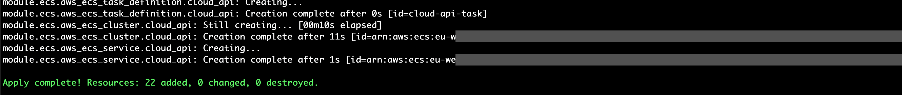
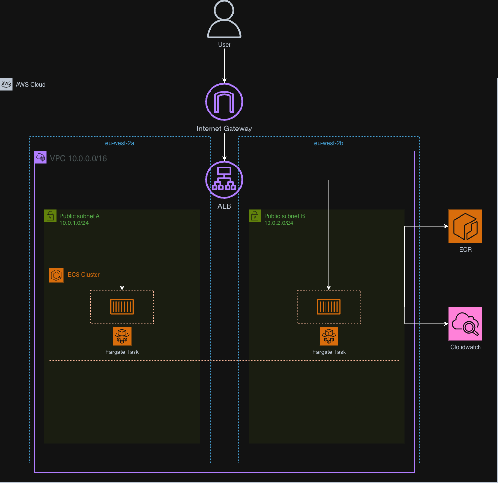
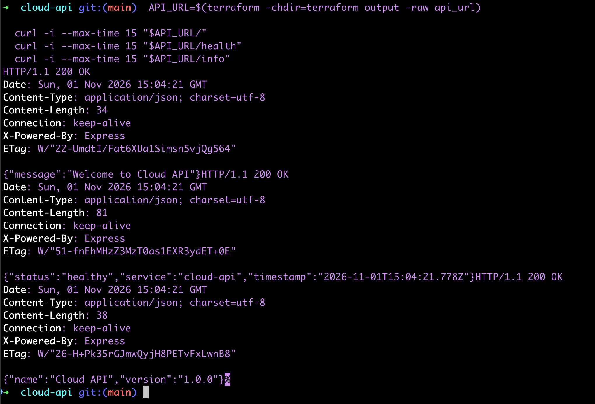
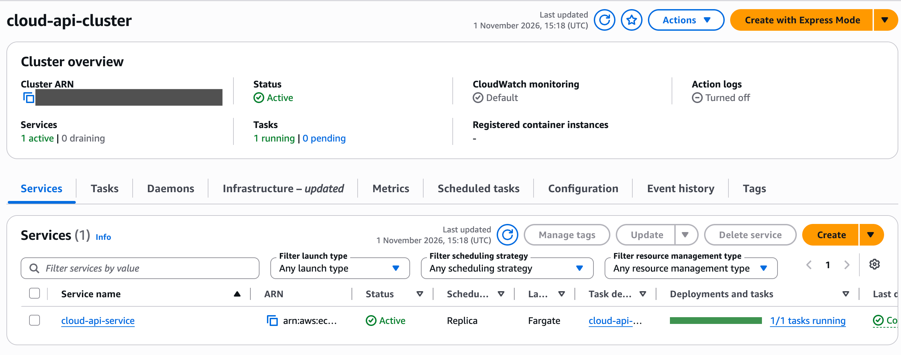
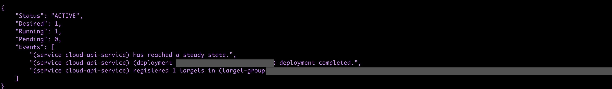
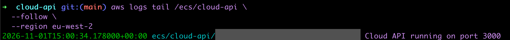
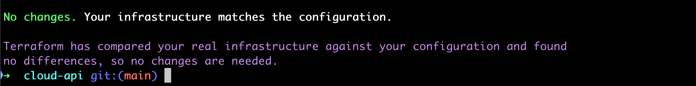
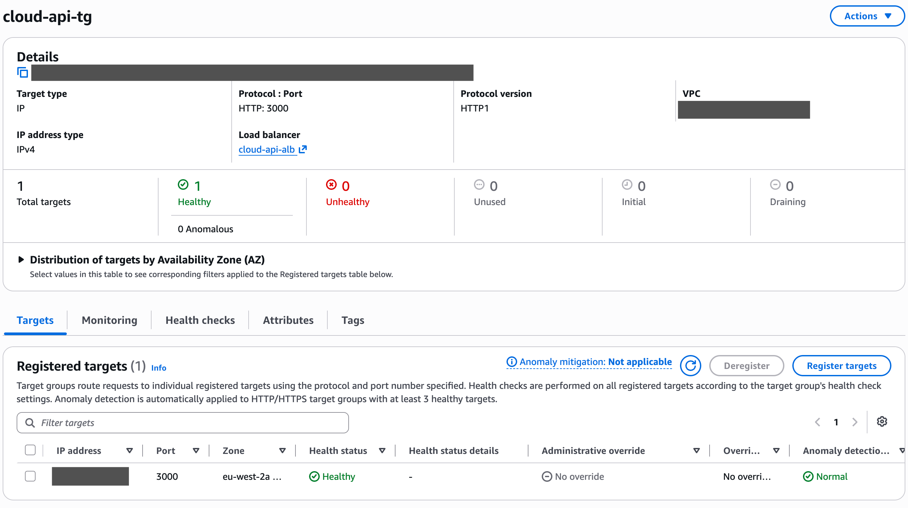
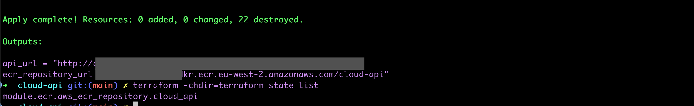

# Cloud API — Terraform & AWS ECS Fargate

A containerised TypeScript/Express REST API deployed to **AWS ECS Fargate** using modular Terraform infrastructure. The project covers Docker builds, private ECR images, VPC networking, load balancing, IAM and CloudWatch logging.

**Deployment verified: 1 November 2026.** All three public endpoints returned HTTP 200, ECS reached steady state, the ALB reported one healthy target and a post-deployment Terraform plan detected no differences.

**Current status:** the 22 demo resources were destroyed after verification to minimise ongoing costs. ECR and the `v1` image are retained. The public API is no longer running.



[API and ECS evidence](#deployment-evidence) ·
[Architecture](docs/architecture.md) ·
[Troubleshooting](docs/troubleshooting.md) ·
[Lessons learned](docs/lessons-learned.md) ·
[Deployment guide](docs/deployment.md)

## Technology stack

| Area | Technologies |
| --- | --- |
| Backend | TypeScript, Node.js, Express |
| Testing | Node.js test runner, Supertest |
| Containers | Docker, multi-stage builds, non-root runtime |
| Infrastructure | Terraform, AWS provider, seven local modules |
| Compute | Amazon ECS, Fargate, Linux ARM64 |
| Networking | Amazon VPC, ALB, subnets, route tables, security groups |
| Registry | Amazon ECR, immutable image tags, scanning on push |
| Monitoring | Amazon CloudWatch Logs, seven-day retention |
| Identity | AWS IAM task execution role |

## Architecture



The diagram shows task placement in both Availability Zones as a conceptual layout. The verified MVP ran **one task**, not one per zone; the service can place it in either public subnet. The ALB is one resource spanning both subnets and forwards through an IP target group to the task on port 3000.

Key trade-offs:

- **Public subnets:** avoided a NAT gateway for this low-cost learning deployment. Tasks use public IPs for outbound access; only the ALB security group can initiate inbound API connections.
- **One task:** kept compute usage small, but provides no application-level high availability. Two ALB zones do not change that limitation.
- **HTTP MVP:** public demo traffic uses port 80 without encryption. HTTPS is planned.
- **ARM64 and bounded logs:** matched the verified image architecture and limited retained container logs to seven days.

See [architecture and design decisions](docs/architecture.md) for the full inventory, security boundaries and module refactor details.

## Features

- Three JSON endpoints, including a dynamic health timestamp.
- Tested Express application with separate server startup.
- Multi-stage Docker image running as a non-root user.
- Private, versioned ECR image deployed through an ARM64 Fargate task definition.
- ALB health checks, ECS deployment circuit breaker and centralised container logs.
- Reproducible infrastructure with a verified deploy, drift check and teardown cycle.

## Endpoints

| Method | Path | Purpose |
| --- | --- | --- |
| GET | `/` | Returns a welcome message |
| GET | `/health` | Returns service health and a dynamically generated timestamp |
| GET | `/info` | Returns the application name and version |

## Quick start

### Local development

Prerequisites: Node.js 22 and npm. From the project root:

```bash
npm ci
npm run dev
```

Open `http://localhost:3000/health`. The server binds to `0.0.0.0`; `PORT` defaults to `3000`.

To compile and run JavaScript:

```bash
npm run build
npm start
```

Use `PORT=3001 npm start` to override the port. Stop the server with `Ctrl+C`.

### Docker

With Docker running:

```bash
docker build -t cloud-api:local .
docker run --rm --name cloud-api -p 3001:3000 cloud-api:local
```

In another terminal:

```bash
curl http://localhost:3001/
curl http://localhost:3001/health
curl http://localhost:3001/info
```

The mapping exposes container port 3000 on host port 3001. Stop with `Ctrl+C`; `--rm` removes the stopped container. Verify the runtime user with `docker run --rm cloud-api:local whoami`; expect `node`.

## Testing

```bash
npm test
npm run build
```

The endpoint tests check HTTP status, response fields and a parseable health timestamp. Supertest opens temporary local ports, so the environment must allow port binding.

## Terraform infrastructure

Prerequisites: Terraform 1.5+, AWS CLI and credentials for the intended account. Infrastructure targets London (`eu-west-2`).

```bash
aws sts get-caller-identity
terraform -chdir=terraform init
terraform -chdir=terraform fmt -recursive -check
terraform -chdir=terraform validate
terraform -chdir=terraform plan
```

| Module | Responsibility |
| --- | --- |
| `networking` | VPC, two subnets, internet gateway and routes |
| `security` | ALB and ECS security groups and traffic rules |
| `alb` | Load balancer, HTTP listener, IP target group and health check |
| `iam` | ECS execution role and managed policy attachment |
| `logging` | CloudWatch log group and retention |
| `ecr` | Private container registry |
| `ecs` | Cluster, ARM64 task definition and single-task service |

State is local; state files, backups and credentials must stay out of Git. Commit the provider lockfile. The `environment` variable defaults to `dev` and labels resources; it does not isolate deployments.

**After teardown, a normal plan proposes 22 additions. Applying it recreates the demo and resumes ALB, compute, public IPv4 and logging usage.** ECR storage remains in use. See the [deployment guide](docs/deployment.md) for registry commands, verification and teardown scope.

## Deployment evidence

Evidence captured on **1 November 2026** during the AWS deployment. Images are cropped copies of the original screenshots; visible account IDs and selected resource identifiers are masked. Commands, status values and results are preserved. The demo was subsequently torn down; these are historical verification results.

### Successful API responses

Requests to `/`, `/health` and `/info` through the ALB all returned **HTTP 200** and the expected JSON. The health response contains a request-time timestamp.



### ECS service health

The ECS console showed an active service on Fargate with **1/1 tasks running** and no pending tasks.



<details>
<summary><strong>Deployment evidence — events, logs, drift check, target health and teardown</strong></summary>

### ECS events

The service reported steady state, deployment completion and target registration.



### CloudWatch logs

The container's startup message reached the configured CloudWatch log stream.



### Terraform post-deployment drift check

After deployment, Terraform reported **“No changes. Your infrastructure matches the configuration.”** This confirms that no differences were detected between the managed infrastructure and configuration at that check; it is not a guarantee against future drift.



### ALB target health

The target group showed **one healthy IP target**, zero unhealthy targets and application traffic on port 3000.



### Teardown and ECR preservation

The teardown removed 22 demo resources. The following state listing contained only `module.ecr.aws_ecr_repository.cloud_api`. The old API URL printed after the targeted teardown was a stale output, not a running endpoint.



</details>

## Challenges and lessons learned

The project involved correcting NodeNext imports, Docker stage paths, the container runtime user, an ALB listener protocol and an IAM trust principal. These are documented with their actual symptoms and fixes:

- [Troubleshooting](docs/troubleshooting.md): issues, solutions and teardown observations.
- [Lessons learned](docs/lessons-learned.md): module boundaries, state migration, verification and cost control.
- [Architecture](docs/architecture.md): design decisions, inventory and security limitations.

## Future improvements

These are planned extensions, not implemented features:

- **CI:** run endpoint tests, TypeScript compilation and Docker builds on pull requests; add lint tooling and include it in the checks.
- **AWS authentication:** configure GitHub Actions OIDC with repository, branch and environment restrictions instead of long-lived AWS access keys.
- **CD:** publish an image tagged with the commit SHA, register a new task definition revision and verify ECS deployment health. Define deployment ownership so Terraform and CI do not fight over task revisions.
- **State management:** move local state to S3 with access controls, encryption, versioning and locking; separate persistent ECR from disposable runtime resources.
- **Security and operations:** add HTTPS through ACM and a domain, image cleanup, cost alerts and a review of IAM scope and network egress. Reassess private subnets and multiple tasks against cost and availability requirements.
