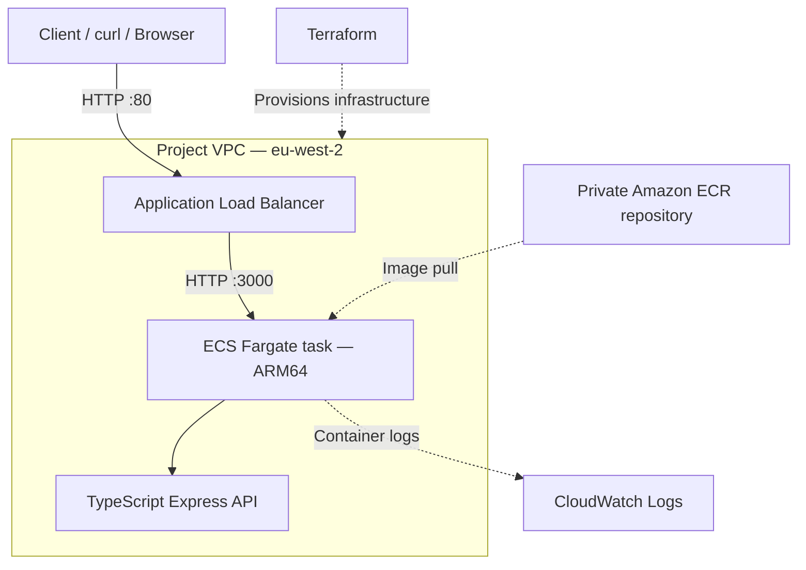

# Cloud API

## Contents

- [Overview](#overview)
- [Features](#features)
- [Architecture Diagram](#architecture-diagram)
- [System Design](#system-design)
- [Issues and Solutions](#issues-and-solutions)
- [Lessons Learnt](#lessons-learnt)
- [The Journey](#the-journey)
- [Endpoints](#endpoints)
- [Run locally](#run-locally)
- [Tests](#tests)
- [Run with Docker](#run-with-docker)
- [Terraform workflow](#terraform-workflow)
- [Container registry](#container-registry)
- [Infrastructure configuration](#infrastructure-configuration)
- [Project structure](#project-structure)
- [Planned milestones](#planned-milestones)
- [Screenshots and Verification](#screenshots-and-verification)

## Overview

Cloud API is a portfolio project exploring the complete path from a TypeScript Express application to a containerised AWS deployment managed with Terraform. The focus is practical cloud engineering: packaging an application, publishing images, designing networking, controlling access and understanding deployment costs.

The API runs locally and in Docker. A private Amazon ECR repository has been provisioned with Terraform, and the `v1` Linux ARM64 image has been pushed, pulled and tested locally. The API is not yet running on AWS.

Terraform configuration also defines networking, security groups, an Application Load Balancer and an ECS execution role. These resources have not yet been applied.

## Features

- Three JSON endpoints, including a health endpoint with a dynamic timestamp.
- TypeScript with native ES Modules and endpoint tests using Supertest and Node's test runner.
- Multi-stage Docker build with production dependencies and a non-root runtime user.
- Private ECR repository with immutable image tags and scanning on push.
- Terraform definitions for a VPC, two subnets across Availability Zones and internet routing.
- Separate ALB and ECS security groups restricting inbound application traffic to the ALB.
- ALB HTTP listener and IP target group with application health checks, defined in Terraform.
- ECS execution role for pulling images and publishing logs, defined in Terraform.

See [Infrastructure configuration](#infrastructure-configuration) for deployment status. The ECS task definition includes CloudWatch logging; the ECS service is still to be implemented.

## Architecture Diagram

Target deployment architecture; the ALB, ECS service and logging path are not yet deployed:



The ALB spans public subnets in `eu-west-2a` and `eu-west-2b`. Subnets in two zones prepare the network for the ALB; they do not by themselves make the application highly available. Task count and placement will be decided when the ECS service is configured.

## System Design

- **Express and TypeScript:** A small API keeps the application easy to understand while the project focuses on infrastructure. Application setup is separate from server startup, allowing endpoint tests to import the app without starting the production listener.
- **Multi-stage Docker build:** TypeScript compilation happens in a builder stage. The runtime stage receives compiled JavaScript and production dependencies, leaving build tools out of the final image. The API runs as the `node` user because serving requests on port 3000 does not require root.
- **ECR and immutable tags:** The registry provides an image location that ECS can access. Version tags identify releases, and immutability prevents a published tag from silently being replaced. Scanning is enabled to help identify vulnerabilities; it does not guarantee an image is secure.
- **ECS Fargate:** The planned compute platform avoids managing EC2 hosts. The verified image is ARM64, so the task definition must use the same architecture. ECS is sufficient for this single-service project without introducing Kubernetes operations.
- **Public subnet MVP:** The intended deployment uses public subnets and public IP assignment for Fargate outbound connectivity, avoiding a NAT gateway for this learning environment. Tasks will accept inbound API traffic only from the ALB security group. Private subnets with controlled egress remain a possible later improvement.
- **ALB and health checks:** The listener accepts HTTP on port 80 and forwards to task IP addresses on port 3000. The target group checks `/health` for HTTP 200. This endpoint currently reports application responsiveness, not dependency health. HTTPS is planned separately.
- **IAM role separation:** The execution role grants ECS permissions for image downloads and logging. It is distinct from a task role, which would grant the application access to AWS APIs. The current API does not need application-level AWS permissions.
- **Terraform and deployment timing:** Resource references describe dependencies, while plans provide a review point before creating resources. The remaining infrastructure is being defined before deployment so billable compute and load balancing can be tested in a controlled session.

## Issues and Solutions

### TypeScript imports failed to compile

**Issue:** A relative import used `./app` with native ES Modules and `NodeNext` resolution. TypeScript reported that the import needed an explicit extension.

**Solution:** Use `./app.js` in the TypeScript source so the emitted JavaScript resolves correctly at runtime.

### Server startup was duplicated

**Issue:** Both `app.ts` and `server.ts` called `app.listen()`, making importing the application start a listener as a side effect.

**Solution:** Keep route definitions and the app export in `app.ts`; start the listener only in `server.ts`.

### Docker stages referenced different build paths

**Issue:** The builder compiled into `/build/dist`, but the runtime stage initially attempted to copy `/cloud-api/dist` from the builder.

**Solution:** Copy from `/build/dist`. Each stage has its own filesystem and working directory.

### The container ran as root

**Issue:** Running `whoami` in the image returned `root`.

**Solution:** Add `USER node` to the production stage, rebuild the image and verify the runtime user before retesting `/health`.

### The listener protocol did not match the intended setup

**Issue:** Terraform validation succeeded, but plan review revealed an HTTPS listener without a configured certificate, while the intended MVP used HTTP.

**Solution:** Change the listener protocol to HTTP and confirm port 80 in the plan. HTTPS requires its own certificate configuration and security review.

### The execution role trusted the wrong AWS service

**Issue:** The initial trust policy allowed `ec2.amazonaws.com` to assume a role intended for Fargate task execution.

**Solution:** Set the principal to `ecs-tasks.amazonaws.com`. This was caught during configuration review before deployment.

## Lessons Learnt

- A valid Terraform configuration can still express the wrong design. Review actual protocols, principals and resource references in addition to checking resource counts.
- A subnet becomes public through its route to an internet gateway. Naming it `public` or enabling automatic public IP assignment does not establish that route.
- Security group rules and network routes solve different problems: routes establish paths, while security groups control permitted traffic.
- AWS CLI authentication does not automatically authenticate Docker to ECR. Docker requires a registry login before pushing or pulling private images.
- Image architecture is part of deployment compatibility. A working ARM64 image needs matching runtime configuration.
- An environment tag labels resources; it does not provide separate infrastructure, names or Terraform state.
- Small commits preserve the reasoning behind each infrastructure step, even when several steps are eventually deployed together.

## The Journey

1. **Application foundation — complete:** Built and tested the three Express endpoints, configured TypeScript ES Modules and separated app setup from startup.
2. **Containerisation — complete:** Created a multi-stage Dockerfile, verified port mapping and ran the API as a non-root user.
3. **Image registry — complete:** Provisioned ECR, pushed `v1`, pulled it back and verified the health endpoint locally.
4. **Networking and security — defined:** Added the VPC, subnets, routing and ALB/ECS security groups. Deployment is pending.
5. **Load balancing and IAM — defined:** Added the ALB, target group, listener and execution role. Deployment is pending.
6. **Logging and ECS — in progress:** Defined seven-day log retention, the ECS cluster and an ARM64 task definition. The ECS service is next, followed by cost review and deployment.
7. **Delivery automation — later:** Introduce remote Terraform state and GitHub Actions with AWS OIDC authentication.

## Endpoints

| Method | Path | Purpose |
| --- | --- | --- |
| GET | `/` | Returns a welcome message |
| GET | `/health` | Returns service health and a dynamically generated timestamp |
| GET | `/info` | Returns the application name and version |

## Run locally

Prerequisites: Node.js 22 and npm. The Docker image also uses Node.js 22.

From the project directory, install dependencies using the lockfile:

```bash
npm ci
```

Start the development server with automatic reload:

```bash
npm run dev
```

The API listens on `http://localhost:3000`. Stop it with `Ctrl+C`.

To compile TypeScript and run the compiled application:

```bash
npm run build
npm start
```

The server binds to `0.0.0.0` and defaults to port `3000`. Override the port with the `PORT` environment variable, for example:

```bash
PORT=3001 npm start
```

## Tests

Run the endpoint tests with Node's test runner and Supertest:

```bash
npm test
```

The tests cover all three endpoints, including the health response's timestamp format. They start temporary HTTP servers, so the environment must allow local port binding.

## Run with Docker

Prerequisite: Docker installed and running.

Build the image from the project directory:

```bash
docker build -t cloud-api:local .
```

The multi-stage build compiles TypeScript in the builder stage. The runtime stage contains production dependencies and the compiled application, and runs as the non-root `node` user.

Start the container:

```bash
docker run --rm --name cloud-api -p 3001:3000 cloud-api:local
```

The port mapping exposes container port `3000` on your machine at port `3001`. Open `http://localhost:3001`, or use curl from another terminal:

```bash
curl http://localhost:3001/
curl http://localhost:3001/health
curl http://localhost:3001/info
```

Example health response:

```json
{
  "status": "healthy",
  "service": "cloud-api",
  "timestamp": "2026-10-26T14:23:24.572Z"
}
```

The timestamp changes with each request. Stop the container with `Ctrl+C`; `--rm` removes the stopped container.

To check the image's runtime user:

```bash
docker run --rm cloud-api:local whoami
```

Expected output: `node`.

## Terraform workflow

Prerequisites: Terraform 1.5 or newer, AWS CLI with credentials for the intended account, and permission to manage the project resources. The AWS provider uses the `eu-west-2` (London) region.

Confirm the AWS identity before working with infrastructure:

```bash
aws sts get-caller-identity
```

Initialise the working directory, check formatting and validate the configuration:

```bash
terraform -chdir=terraform init
terraform -chdir=terraform fmt -check
terraform -chdir=terraform validate
terraform -chdir=terraform plan
```

These commands do not provision resources. Review every plan before applying. Applying the current configuration will create the pending resources, including a billable ALB; it is not limited to the existing ECR repository. Deployment is intentionally deferred until the ECS configuration and cost review are complete.

The `environment` input variable defaults to `dev` and is used for resource tags. It does not create isolated environments or separate state files. To preview a different label:

```bash
terraform -chdir=terraform plan -var="environment=demo"
```

Terraform currently uses local state. Keep state files, the `.terraform/` directory and credentials out of Git; commit `.terraform.lock.hcl` to retain the selected provider version. Preserve local state because it records the resources Terraform manages. An S3 remote backend is planned for a later milestone.

### Local modules

The root configuration connects seven local modules: `networking`, `security`, `alb`, `iam`, `logging`, `ecr` and `ecs`. Each declares its inputs, outputs and AWS provider requirement; provider configuration and credentials remain at the root. Module outputs pass VPC, subnet and security group IDs between components.

ECR is managed by the `ecr` module. Its existing local state entry was migrated from `aws_ecr_repository.cloud_api` to `module.ecr.aws_ecr_repository.cloud_api` using `terraform state mv`, preserving the repository and its images. No `moved` blocks are used. The ECS cluster and task definition are in the `ecs` module. ECS has not been applied, so moving its configuration required no state migration. The other module resources have not been applied either.

Run `terraform -chdir=terraform init` after introducing the modules, then validate and inspect the plan. The refactor must not replace or destroy ECR. Do not apply until the complete deployment and costs have been reviewed.

## Container registry

The ECR repository uses immutable image tags and scanning on push. Each new image version needs a new tag; an existing tag such as `v1` cannot be overwritten.

From the project root, obtain the repository URL from Terraform and authenticate Docker to its registry:

```bash
ECR_REPOSITORY_URL=$(terraform -chdir=terraform output -raw ecr_repository_url)
ECR_REGISTRY=${ECR_REPOSITORY_URL%/*}

aws ecr get-login-password --region eu-west-2 \
  | docker login --username AWS --password-stdin "$ECR_REGISTRY"
```

To publish an image, choose an unused version tag:

```bash
IMAGE_TAG=v2
docker tag cloud-api:local "$ECR_REPOSITORY_URL:$IMAGE_TAG"
docker push "$ECR_REPOSITORY_URL:$IMAGE_TAG"
```

Verify the uploaded image locally:

```bash
docker run --rm --pull=always --name cloud-api-ecr \
  -p 3002:3000 "$ECR_REPOSITORY_URL:$IMAGE_TAG"
```

In another terminal, run `curl http://localhost:3002/health`. Stop the container with `Ctrl+C` after testing.

The existing `v1` image targets `linux/arm64`. The future Fargate task definition must select ARM64, or the image must be rebuilt for the selected architecture.

## Infrastructure configuration

| Component | Configuration | Deployment status |
| --- | --- | --- |
| ECR | Private repository, immutable tags, scanning on push | Applied; `v1` image verified |
| VPC | `10.0.0.0/16`, DNS support and hostnames enabled | Defined; not applied |
| Public subnets | `10.0.1.0/24` in `eu-west-2a`; `10.0.2.0/24` in `eu-west-2b` | Defined; not applied |
| Internet routing | Internet gateway, public default route and both subnet associations | Defined; not applied |
| Security groups | Public HTTP to ALB; ALB to ECS on TCP 3000; ECS outbound IPv4 access | Defined; not applied |
| ALB | Internet-facing, HTTP listener on 80, IP target group on 3000, `/health` check | Defined; not applied |
| IAM execution role | Trusts ECS tasks; managed policy for ECR pulls and CloudWatch logging | Defined; not applied |
| CloudWatch | Log group with seven-day retention | Defined; not applied |
| ECS cluster | Cluster with Container Insights disabled | Defined; not applied |
| ECS task definition | ARM64, 0.25 vCPU, 512 MiB, ECR `v1`, CloudWatch logging | Defined; not applied |
| ECS service | Task scheduling and ALB registration | Not yet defined |

The intended request path is client → ALB:80 → ECS task:3000 → Express API. Only the ALB security group is allowed to initiate inbound connections to the task's application port. HTTP is currently unencrypted; HTTPS remains a future enhancement.

ECR image storage is already in use. Future deployment can incur ALB, Fargate, public IPv4, logging and data transfer charges. Review estimated costs and a teardown plan before deploying. An ECR repository containing images cannot be deleted with the current default settings until its images are removed; review destruction plans carefully.

## Project structure

```text
src/app.ts        Express application and routes
src/server.ts     Port configuration and server startup
tests/app.test.ts Endpoint tests
Dockerfile        Multi-stage container build
.dockerignore     Files excluded from the Docker build context
tsconfig.json     TypeScript compiler configuration
terraform/
  providers.tf    Terraform and AWS provider configuration
  variables.tf    Input variables, including the environment tag
  main.tf         Local module composition and connections
  outputs.tf      ECR repository URL output
  modules/
    ecs/          ECS cluster and ARM64 task definition
    ecr/          Private image repository
    networking/   VPC, subnets and internet routing
    security/     ALB and ECS security groups and traffic rules
    alb/          Load balancer, target group and listener
    iam/          ECS execution role and policy attachment
    logging/      CloudWatch log group and retention
```

## Planned milestones

- Define the ECS service and connect it to the ALB target group.
- Review costs, deploy the pending infrastructure and verify the API through the ALB.
- Add further security and cost controls, including image cleanup and HTTPS.
- Add S3 remote Terraform state and GitHub Actions with AWS OIDC authentication.

## Screenshots and Verification

No screenshots have been added yet. The following outcomes were verified during implementation:

| Check | Observed result |
| --- | --- |
| Local API requests | All three endpoints returned the expected JSON |
| Docker runtime identity | `whoami` returned `node` |
| Image architecture | `linux/arm64` |
| ECR upload | `v1` pushed successfully |
| ECR pull and local execution | Container started and `/health` returned `healthy` on host port 3002 |

The verified `v1` registry digest was:

```text
sha256:f270f2ca3fbd5c9346f1daee7f6a734ed1c92c536fad5dadd63003ff0523b577
```

Screenshots of the ECR image, healthy ALB targets, public API response and CloudWatch logs will be added as those stages are captured and deployed. Terraform plans demonstrate intended changes; they are not evidence of running infrastructure.
