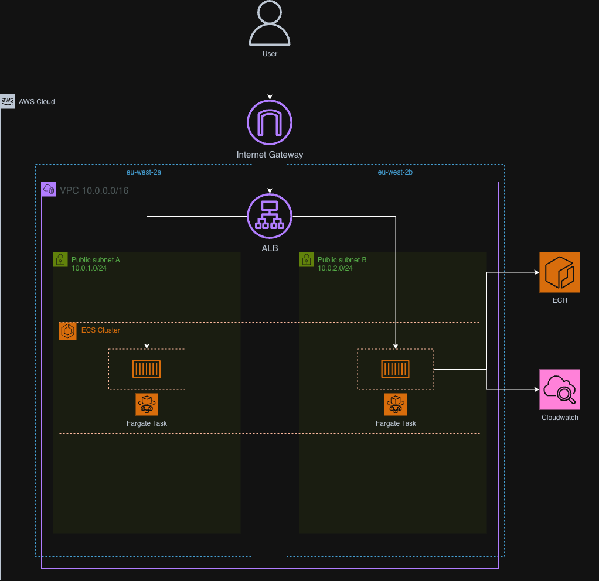

# Architecture and Design Decisions

[Back to the project README](../README.md)

## Deployed topology

The diagram records the verified demo topology. The runtime infrastructure has since been torn down; ECR is retained.



The diagram is conceptual: the ALB is **one regional resource spanning two subnets**. The two task symbols illustrate placement in either Availability Zone; the verified deployment ran **one task in subnet A**, not two tasks. The ECS cluster is a logical grouping rather than a network boundary. An IP target group, omitted from the image, forwards ALB requests to the task on port 3000.

Both subnets use a route table with `0.0.0.0/0` pointing to the internet gateway. The task's public IPv4 address supports outbound connectivity; the ALB forwards to its private IP. The ECS security group accepts TCP 3000 only from the ALB security group. The ALB group accepts public TCP 80 and permits outbound TCP 3000 to the ECS group.

## Decisions and trade-offs

- **Express and TypeScript:** A small API keeps the application easy to understand while the project focuses on infrastructure. Application setup is separate from server startup, allowing endpoint tests to import the app without starting the production listener.
- **Multi-stage Docker build:** TypeScript compilation happens in a builder stage. The runtime stage receives compiled JavaScript and production dependencies, leaving build tools out of the final image. The API runs as the `node` user because serving requests on port 3000 does not require root.
- **ECR and immutable tags:** The registry provides an image location that ECS can access. Version tags identify releases, and immutability prevents a published tag from silently being replaced. Scanning is enabled to help identify vulnerabilities; it does not guarantee an image is secure.
- **ECS Fargate:** The compute platform avoids managing EC2 hosts. The verified image is ARM64, so the task definition must use the same architecture. ECS is sufficient for this single-service project without introducing Kubernetes operations.
- **Public subnet MVP:** The demo deployment used public subnets and public IP assignment for Fargate outbound connectivity, avoiding a NAT gateway for this learning environment. Tasks accept inbound API traffic only from the ALB security group. Private subnets with controlled egress remain a possible later improvement.
- **ALB and health checks:** The listener accepts HTTP on port 80 and forwards to task IP addresses on port 3000. The target group checks `/health` for HTTP 200. This endpoint currently reports application responsiveness, not dependency health. HTTPS is planned separately.
- **IAM role separation:** The execution role grants ECS permissions for image downloads and logging. It is distinct from a task role, which would grant the application access to AWS APIs. The current API does not need application-level AWS permissions.
- **Terraform and deployment timing:** Resource references describe dependencies, while plans provide a review point before creating resources. The infrastructure was deployed for a verification session and torn down afterward to limit ongoing charges.

## Availability and security limits

- One desired task provides no application-level redundancy, even though the ALB spans two Availability Zones.
- HTTP is unencrypted. This public demo has no authentication or sensitive payloads; HTTPS is a future improvement.
- Tasks have public IPs to avoid NAT gateway costs for the MVP. Public IPs incur charges, and ECS outbound IPv4 traffic is broadly allowed. A production design would review isolation and egress requirements.
- The health endpoint checks application responsiveness; it does not verify dependencies.
- The deployment circuit breaker detects failed rollouts. Rollback needs a previous successful deployment, so an initial deployment has nothing to roll back to.

## Infrastructure inventory

| Component | Configuration | Deployment status |
| --- | --- | --- |
| ECR | Private repository, immutable tags, scanning on push | Applied; `v1` image verified |
| VPC | `10.0.0.0/16`, DNS support and hostnames enabled | Deployed, verified, then torn down |
| Public subnets | `10.0.1.0/24` in `eu-west-2a`; `10.0.2.0/24` in `eu-west-2b` | Deployed, verified, then torn down |
| Internet routing | Internet gateway, public default route and both subnet associations | Deployed, verified, then torn down |
| Security groups | Public HTTP to ALB; ALB to ECS on TCP 3000; ECS outbound IPv4 access | Deployed, verified, then torn down |
| ALB | Internet-facing, HTTP listener on 80, IP target group on 3000, `/health` check | Deployed, verified, then torn down |
| IAM execution role | Trusts ECS tasks; managed policy for ECR pulls and CloudWatch logging | Deployed, verified, then torn down |
| CloudWatch | Log group with seven-day retention | Deployed, verified, then torn down |
| ECS cluster | Cluster with Container Insights disabled | Deployed, verified, then torn down |
| ECS task definition | ARM64, 0.25 vCPU, 512 MiB, ECR `v1`, CloudWatch logging | Deployed, verified, then torn down |
| ECS service | One Fargate task, ALB registration and deployment circuit breaker | Deployed, verified, then torn down |

The verified request path was client → ALB:80 → ECS task:3000 → Express API. Only the ALB security group is allowed to initiate inbound connections to the task's application port. HTTP is currently unencrypted; HTTPS remains a future enhancement.

ECR image storage is already in use. Future deployment can incur ALB, Fargate, public IPv4, logging and data transfer charges. Review estimated costs and a teardown plan before deploying. An ECR repository containing images cannot be deleted with the current default settings until its images are removed; review destruction plans carefully.

## Module refactor


The root configuration connects seven local modules: `networking`, `security`, `alb`, `iam`, `logging`, `ecr` and `ecs`. Each declares its inputs, outputs and AWS provider requirement; provider configuration and credentials remain at the root. Module outputs pass VPC, subnet and security group IDs between components.

ECR is managed by the `ecr` module. Its existing local state entry was migrated from `aws_ecr_repository.cloud_api` to `module.ecr.aws_ecr_repository.cloud_api` using `terraform state mv`, preserving the repository and its images. No `moved` blocks are used. The ECS cluster, task definition and service are in the `ecs` module. The other modules were reorganised before their initial deployment, so they required no state migration. All demo modules were subsequently deployed, verified and torn down.

Run `terraform -chdir=terraform init` after introducing the modules, then validate and inspect the plan. The refactor must not replace or destroy ECR. Do not apply until the complete deployment and costs have been reviewed.

## Project structure

```text
docs/screenshots/ Cropped deployment and teardown evidence
src/app.ts        Express application and routes
src/server.ts     Port configuration and server startup
tests/app.test.ts Endpoint tests
Dockerfile        Multi-stage container build
.dockerignore     Files excluded from the Docker build context
tsconfig.json     TypeScript compiler configuration
terraform/
  providers.tf    Terraform and AWS provider configuration
  variables.tf    Input variables, including the environment tag
  main.tf         Local module composition and connections
  outputs.tf      ECR repository URL and public API URL outputs
  modules/
    ecs/          ECS cluster, ARM64 task definition and service
    ecr/          Private image repository
    networking/   VPC, subnets and internet routing
    security/     ALB and ECS security groups and traffic rules
    alb/          Load balancer, target group and listener
    iam/          ECS execution role and policy attachment
    logging/      CloudWatch log group and retention
```
